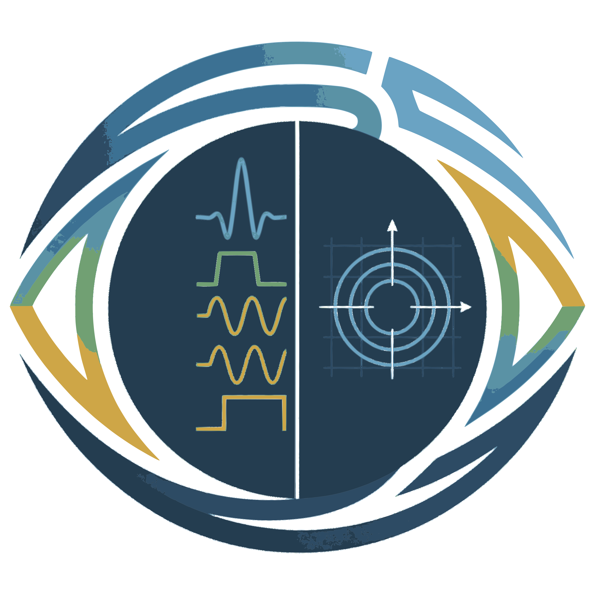
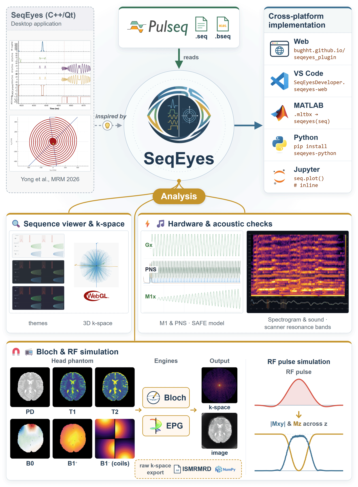
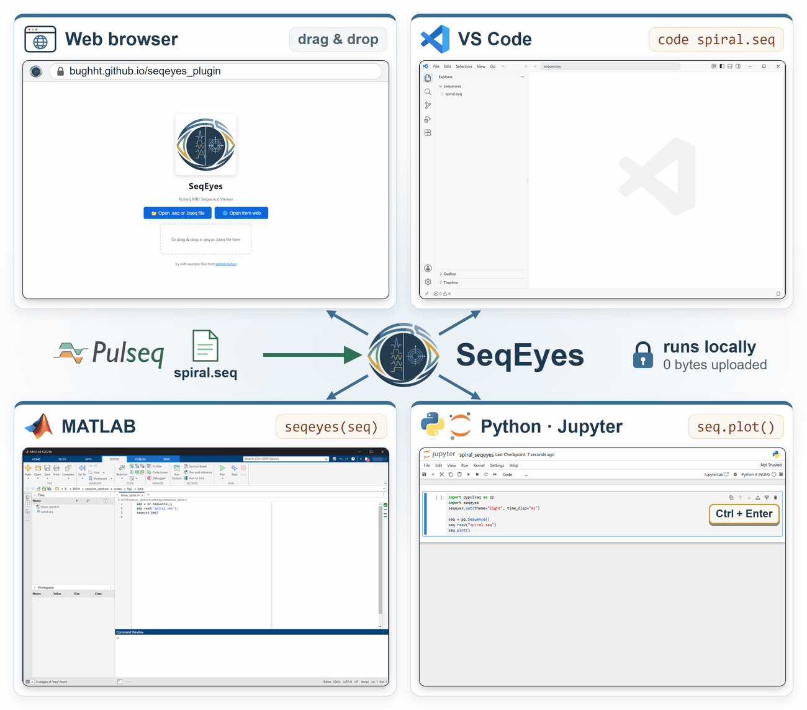
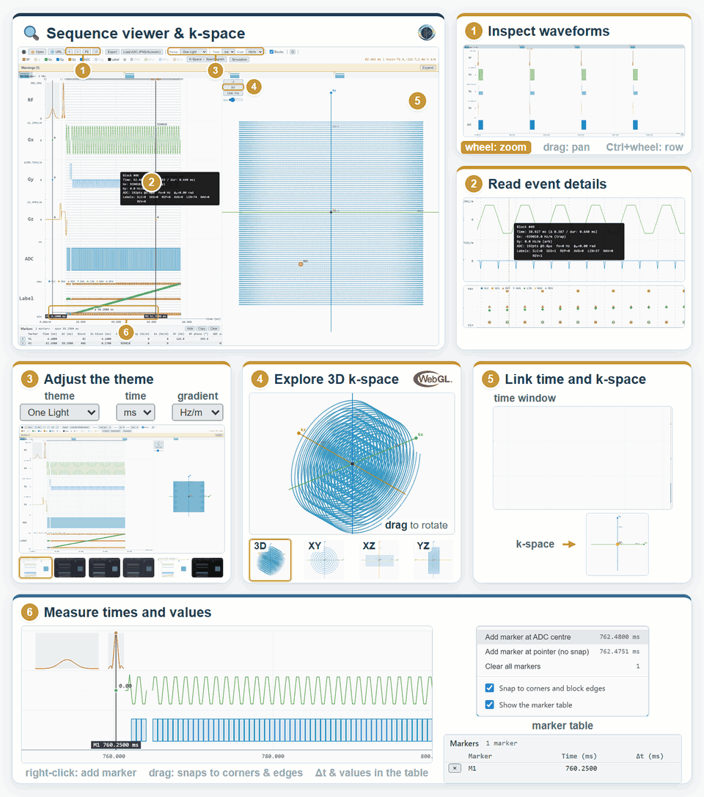
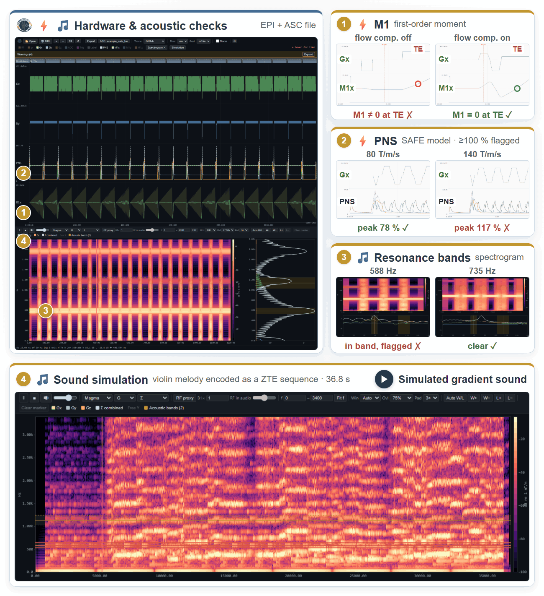
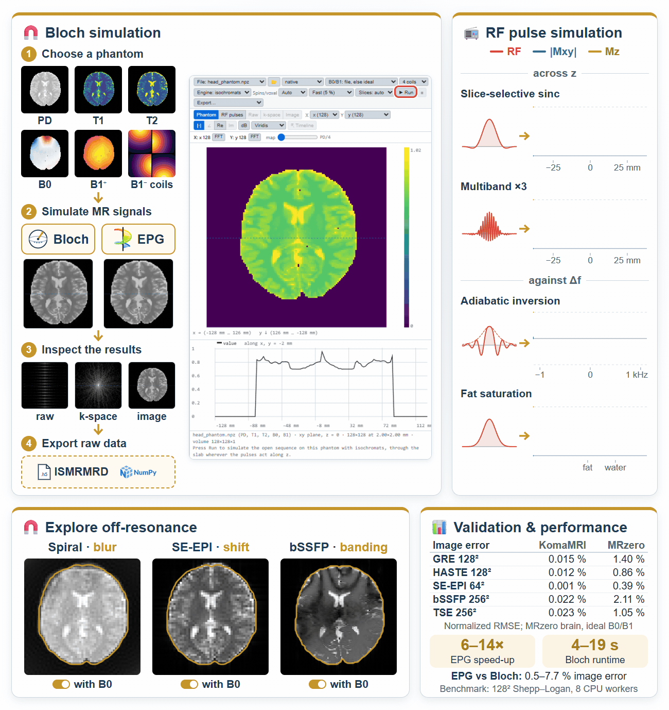

<p align="center">
  
</p>

<h1 align="center">SeqEyes</h1>

<p align="center">
  <b>A cross-platform interactive viewer for <a href="https://github.com/pulseq/pulseq">Pulseq</a> MRI sequences.</b><br />
  Inspect waveforms and 3D k-space, check M1, PNS and acoustic resonances, and simulate the signal on a phantom,<br />
  in your browser, VS Code, MATLAB, Python or Jupyter. Everything runs on your own machine.
</p>

<p align="center">
  <a href="https://bughht.github.io/seqeyes_plugin/"></a>
  <a href="https://marketplace.visualstudio.com/items?itemName=SeqEyesDeveloper.seqeyes-web"></a>
  <a href="https://github.com/bughht/seqeyes_plugin/releases"></a>
  <a href="https://pypi.org/project/seqeyes-python/"></a>
  <a href="https://github.com/bughht/seqeyes_plugin/blob/main/LICENSE.txt"></a>
</p>

<p align="center">
  <a href="https://bughht.github.io/seqeyes_plugin/"><b>🌐 Try it in your browser, no install needed</b></a>
  &nbsp;·&nbsp; <a href="#-install">Install</a>
  &nbsp;·&nbsp; <a href="#-sequence-viewer--k-space">Viewer</a>
  &nbsp;·&nbsp; <a href="#-hardware--acoustic-checks">Hardware checks</a>
  &nbsp;·&nbsp; <a href="#-bloch--rf-simulation">Simulation</a>
  &nbsp;·&nbsp; <a href="#-controls">Controls</a>
</p>

<p align="center">
  
</p>

| **`.seq` · `.bseq`** | **5 hosts** | **5–7 s** | **0 bytes** |
|:---:|:---:|:---:|:---:|
| Pulseq v1.2–v1.5 text and v1.5.2 binary | web, VS Code, MATLAB, Python and Jupyter share one engine | to open a 176 MB `.bseq` with 512,768 blocks in the browser | uploaded: parsing, analysis and simulation run locally |

## 💻 Use it where you write sequences

<p align="center">
  
</p>

| Host | Get it | Open a sequence |
|---|---|---|
| 🌐 **Web** | [bughht.github.io/seqeyes_plugin](https://bughht.github.io/seqeyes_plugin/), nothing to install | Drag & drop a `.seq` / `.bseq`, or **📂 Open** / **🌐 URL** |
| **VS Code** | `code --install-extension SeqEyesDeveloper.seqeyes-web` | Double-click a `.seq` / `.bseq` in the Explorer |
| **MATLAB** | `seqeyes-*.mltbx` from [Releases](https://github.com/bughht/seqeyes_plugin/releases) (R2022a+) | `seqeyes(seq)` on an `mr.Sequence`, or double-click a file |
| **Python** | `pip install seqeyes-python` | `seqeyes.set()` once, then `seq.plot()` as usual |
| **Jupyter** | the same package | `seq.plot()` renders inline in the cell output |

Every host embeds the same viewer, so the viewer and hardware checks below work in all of them. The Bloch
simulation is available in the web app and VS Code. Sequence files stay in memory on your machine.

## 🔍 Sequence viewer & k-space

<p align="center">
  
</p>

1. **Inspect waveforms.** Scroll to zoom around the cursor, drag to pan, and `Ctrl` + scroll to scale a single row.
   **Fit** brings the whole sequence back.
2. **Read event details.** Hover a block to see its timing, gradient, RF and ADC values and acquisition labels
   (SLC, LIN, REP, …).
3. **Adjust the theme.** Choose one of six themes (or follow the system), time in s / ms / µs and gradients in
   Hz/m, mT/m or G/cm. Your choices come back next session.
4. **Explore 3D k-space.** **K-Space / Spectrum** opens a WebGL point cloud of every ADC sample. Drag to rotate;
   **Prj** steps through the XY, XZ and YZ views.
5. **Link time and k-space.** The k-space view shows only the samples inside the visible time window, so panning the
   waveforms walks along the trajectory.
6. **Measure times and values.** Right-click the waveforms and choose **Add marker**. Markers snap to gradient
   corners, RF/ADC edges and centres and block boundaries; Δt and each channel's value go into a table you can copy.

**Large files** open as an overview and load waveform detail as you zoom in. Text `.seq` v1.2.0–v1.5.x and binary
`.bseq` v1.5.2 are read without conversion.

## ⚡ Hardware & acoustic checks

<p align="center">
  
</p>
<p align="center"><sub>EPI test sequences with an example ASC profile (SAFE example coefficients and synthetic resonance bands, not a real scanner).
Panel 4 plays a violin melody encoded as a ZTE sequence.</sub></p>

1. **First-order moment (M1).** Click **M1x**, **M1y** or **M1z** in the legend to calculate M1 on that axis, for
   example to check that flow compensation nulls M1 at TE.
2. **PNS.** **Load ASC (PNS/Acoustic)** reads your scanner's ASC profile. SeqEyes predicts PNS X / Y / Z / Norm with
   the SAFE model, and values of 100 % or more are flagged.
3. **Spectrogram with resonance bands.** Click **K-Space / Spectrum** twice to open the gradient spectrogram of the
   visible window. The profile's forbidden bands are drawn over it, so a readout inside a band stands out.
4. **Sound simulation.** **▶** in the spectrogram panel plays the simulated gradient sound with a synchronized
   playhead.

> **Note:** PNS and the band check are advisory predictions, not a safety or compliance test. The sound is simulated
> from the gradient waveforms and is not calibrated. See [Gradient spectrogram and acoustic bands](#gradient-spectrogram-and-acoustic-bands).

## 🧲 Bloch & RF simulation

In the web app and VS Code, the **Simulation** button simulates the open sequence on a phantom in Web Workers on your
own machine, with no server involved.

<p align="center">
  
</p>
<p align="center"><sub>Head phantom with B0, B1 and four receive coils. The spiral image under “Explore off-resonance” was reconstructed
offline (NUFFT); the in-app reconstruction is Cartesian.</sub></p>

1. **Choose a phantom.** The built-in Shepp–Logan (2-D or 3-D), the MRzero brain, BrainWeb subjects at 3 T and 7 T,
   or your own PD, T1, T2, T2′, ADC, B0 and B1 maps (`.npz`, `.npy`, `.mat` or NIfTI).
2. **Simulate MR signals.** Press **▶ Run**. *Isochromats* (Bloch) simulate spins in every voxel and are the
   reference; the *phase graph* (EPG) engine tracks states per tissue class and is 6–14× faster on our benchmarks.
   An accuracy preset, from Accurate (2 %) to Instant (50 %), trades precision for speed.
3. **Inspect the results.** The **Raw**, **k-space** and **Image** tabs open in an N-D viewer: magnitude, phase,
   real, imaginary or dB, an FFT along any axis, and hovering a raw sample marks its time on the sequence timeline.
4. **Export raw data.** **Export…** writes ISMRMRD (`.h5` or stream), NumPy (`.npz`) or the current view as PNG.

- **Evaluate RF pulses.** The **RF pulses** tab plots each pulse's tip angle, |Mxy| and Mz across z, or against
  off-resonance, for slice-selective, multiband, adiabatic and fat-saturation pulses alike, as soon as a sequence is
  open.
- **Explore off-resonance.** With the phantom's B0 map switched on, the simulation shows spiral blurring, EPI shifts
  and bSSFP banding.

Not yet supported: non-Cartesian gridding in the app, anisotropic or restricted diffusion, dynamic pTx, and the MATLAB
and Python hosts. See [Simulation in depth](#simulation-in-depth) for the engines, accuracy tiers and phantom formats.

## 📊 Validation & performance

| **≤ 0.023 %** | **6–14×** | **≤ 10⁻⁵ m⁻¹** | **0.5 s** |
|:---:|:---:|:---:|:---:|
| image error against KomaMRI | phase-graph speed-up over Bloch | k-space difference from Pulseq MATLAB | to parse a 176 MB `.bseq` |

**Simulation accuracy.** Image NRMSE of SeqEyes isochromats (Accurate preset) against two independent simulators, on
the MRzero 2-D brain with ideal B0/B1, one coil and the same reconstruction:

| Sequence | vs KomaMRI 0.13 | vs MRzeroCore 1.0.5 |
|---|--:|--:|
| Spoiled GRE 128² | 0.015 % | 1.40 % |
| HASTE 128² | 0.012 % | 0.86 % |
| SE-EPI 64² | 0.001 % | 0.39 % |
| bSSFP 256² | 0.022 % | 2.11 % |
| TSE 256² | 0.023 % | 1.05 % |

The gap to MRzero matches MRzero's own spread against KomaMRI (0.39–2.05 %), mostly from MRzero's instantaneous RF
pulses.

**Simulation speed.** On a 128² Shepp–Logan (Accurate preset, 8 Web Workers, Ryzen 9 8945HX), isochromat runs of
GRE, TSE, EPI and bSSFP take 4–19 s; the phase-graph engine is 6–14× faster, with 0.5–7.7 % image error.

**Viewer accuracy.** ADC k-space checkpoints of 11 Pulseq test sequences agree with Pulseq MATLAB within 10⁻⁵ m⁻¹
(largest difference 1.2 × 10⁻⁶ m⁻¹).

**Large files.** A 4D-flow 3D radial sequence with 512,768 blocks parses in 0.5 s as `.bseq` (176 MB) and 3.9 s as
`.seq` (481 MB) in Node.js on an Apple M3 Pro; the `.bseq` opens in the browser in 5–7 s.

Tests and evidence: [yeewantung/seqeyes-plus-experiments](https://github.com/yeewantung/seqeyes-plus-experiments).

## 📦 Install

### 🌐 Web app

**[→ bughht.github.io/seqeyes_plugin](https://bughht.github.io/seqeyes_plugin/)**

No download, no extension, no setup. Drag & drop a `.seq` or `.bseq` file onto the page, click **📂 Open**, or click
**🌐 URL** and paste a link to a raw `.seq` / `.bseq` file. The Pulseq engine runs entirely in the browser: parsing and
calculation happen in browser memory, and sequence data is never uploaded.

### VS Code extension

`.seq` and `.bseq` files open automatically in the SeqEyes custom editor. Install from the
[Marketplace](https://marketplace.visualstudio.com/items?itemName=SeqEyesDeveloper.seqeyes-web), or:

```
code --install-extension SeqEyesDeveloper.seqeyes-web
```

<details>
<summary>Build from source</summary>

```bash
git clone https://github.com/bughht/seqeyes_plugin.git
cd seqeyes_plugin
npm install
npm run package
code --install-extension seqeyes-web-*.vsix --force
```

Or press **F5** to launch the Extension Development Host.

</details>

### 🧪 MATLAB toolbox

Open in-memory Pulseq sequences, text `.seq` files or binary `.bseq` files directly inside MATLAB. Requires R2022a+.

**Option 1: install the toolbox.** Download `seqeyes-*.mltbx` from
[GitHub Releases](https://github.com/bughht/seqeyes_plugin/releases) and double-click it, or run:

```matlab
matlab.addons.toolbox.installToolbox('seqeyes-<version>.mltbx')
```

The installed toolbox is self-contained: it includes `seqeyes.m` and the bundled web viewer assets, so you do not need
to keep a GitHub checkout after installing it.

**Option 2: use the source checkout.** Clone or download this repository, then add its `matlab` folder to the MATLAB
path. `seqeyes(seq)` then uses the web assets from the checkout.

```matlab
addpath(genpath('/path/to/seqeyes_plugin/matlab'))
```

**Usage**

```matlab
seqeyes(seq)                  % open an in-memory mr.Sequence object
seqeyes('spiral_inout.seq')   % open a saved .seq file
open('spiral_inout.seq')      % or double-click in Current Folder
seqeyes('gre.bseq')           % open a saved binary .bseq file
open('gre.bseq')              % or double-click in Current Folder
seqeyes()                     % open an empty viewer
```

No manual `.seq` export is needed for `mr.Sequence` objects; SeqEyes writes a temporary file internally and does not
modify Pulseq files or classes. The viewer opens in a native MATLAB figure.

### 🐍 Python package

An interactive replacement for `pypulseq.Sequence.plot()` that renders in Jupyter cell output or opens in your default
browser. Requires Python ≥ 3.9.

```bash
pip install seqeyes-python             # viewer only
pip install seqeyes-python[pypulseq]   # with pypulseq integration
```

```python
import seqeyes

# Enable SeqEyes (once per session): seq.plot() is now interactive
seqeyes.set(theme="dark", time_disp="ms")

# Build your sequence with pypulseq as usual
seq.plot()                          # interactive viewer in Jupyter
seq.plot(show_blocks=True)          # per-call overrides
seq.plot(time_range=(0, 0.05))      # zoom to first 50 ms

# Restore matplotlib at any time
seqeyes.reset()
```

## 🧭 Controls

**Waveforms**

| Action | How |
|--------|-----|
| Open a `.seq` or `.bseq` file | Double-click it in the VS Code Explorer, drag it onto the web app, or click **📂 Open** |
| Open a web link | In the web app, click **🌐 URL** and paste a raw `.seq` or `.bseq` link |
| Zoom time | Scroll wheel, or toolbar `+` / `−` |
| Zoom one row's y-axis | `Ctrl` + scroll wheel over the row |
| Fine wheel zoom | Hold `Alt` while scrolling; `Ctrl` + `Alt` + scroll gives finer y-axis zoom where the browser/OS supports it |
| Pan | Click & drag |
| Fit to view | Toolbar `Fit` |
| Show / hide a channel | Click its legend label |
| Block details & values | Hover the waveform |
| Block boundaries | `Blocks` checkbox in the toolbar |
| Calculate M1 | Select `M1x`, `M1y` or `M1z` in the legend; the legend toggles each axis |
| Load an ASC profile | `Load ASC (PNS/Acoustic)`, then choose a scanner ASC. PNS coefficients and acoustic resonances are read independently: a file carrying only one still loads, and the viewer says which it found |
| Switch theme and units | Toolbar `Theme`, `Time` and `Grad` dropdowns |

**Measurement markers**

| Action | How |
|--------|-----|
| Add a marker | Right-click (or long-press) the waveform → **Add marker** |
| Place it off the snap points | **Add marker at pointer (no snap)**, or hold `Shift` while dragging |
| Move a marker | Drag it |
| Remove markers | Right-click next to one, use the table's ×, or **Clear** |
| Copy the readouts | **Copy** in the marker table (tab-separated) |

**Analysis panel: 3D k-space**

| Action | How |
|--------|-----|
| Cycle the analysis panel | Toolbar button: closed → **K-Space** → **Spectrogram** → closed. The label always names what the next click does |
| Rotate 3D view | Left-drag in the k-space panel |
| Pan 3D view | Right-drag or middle-drag |
| Zoom k-space (at cursor) | Scroll wheel in the k-space panel |
| Cycle camera preset | `Prj` button: xy → xz → yz → 3D |
| Reset k-space view | `↺` button |
| Toggle k-space unit | `Unit` button: 1/m ↔ rad/m |
| ADC marker size | `Size` slider in the k-space panel |
| Resize the analysis panel | Drag the outer edge handle |

**Analysis panel: spectrogram & sound**

| Action | How |
|--------|-----|
| Resize the spectrogram / spectrum split | Drag the divider between the sub-panes (3:1 by default, remembered per orientation) |
| Window / level the spectrogram | Middle-drag: horizontal = window width, vertical = level. Middle-double-click, or `Auto W/L`, resets. Two-finger drag on touch; the `W±` / `L±` buttons do the same |
| Place a time marker | Right-click the spectrogram (or long-press on touch). The spectrum sub-pane shows that column; `Esc` or `Clear marker` removes it. With no marker the sub-pane shows the view average |
| Change the frequency range | `f min` / `f max` boxes, or scroll/drag on the frequency axis; `Fit f` returns to 0–3000 Hz |
| Change colormap | Colormap dropdown: Viridis (default), Magma, Inferno, Turbo, Greyscale, Theme |
| Analyse slew rate instead of amplitude | Source dropdown: `G` → `dG/dt` |
| Play the simulated gradient sound | `▶` at the top-left of the panel. Playback runs from the marker (or the window start) to the end of the visible window |

**Simulation (web app and VS Code)**

| Action | How |
|--------|-----|
| Open the simulation panel | Toolbar **Simulation** |
| Pick a phantom, fields and coils | Phantom, matrix, `B0/B1` and coil dropdowns; **Your file…** loads your own maps |
| Pick the engine and accuracy | `Engine: isochromats` / `Engine: phase graph`, then the accuracy preset |
| Run or cancel | **▶ Run** (**▶ Run again** after a result) and the stop button |
| Browse the data | **Phantom**, **RF pulses**, **Raw**, **k-space** and **Image** tabs; choose the X / Y dimensions, the others get sliders |
| Find a readout on the timeline | Hover the raw data; **⇱ Timeline** brings the selected readout into view |
| Export | **Export…**: ISMRMRD `.h5` or stream, NumPy `.npz`, or the current view as PNG |

**Settings**

| Action | How |
|--------|-----|
| Stop remembering settings | ⚙ in the toolbar, then untick **Remember my settings**. **Forget stored settings** deletes what is already there |

## 📖 In depth

### Gradient spectrogram and acoustic bands

The analysis panel has three states, cycled by one toolbar button: closed, k-space trajectory, and gradient
spectrogram.

<details>
<summary>What the spectrogram shows, acoustic bands, simulated sound, and limits</summary>

#### What the spectrogram shows

The time × frequency content of the three **physical** gradient axes — the
logical channels with each block’s rotation extension applied, because acoustic
behaviour is a property of the coils, not of the logical axes. Values are
magnitudes in mT/m (or T/m/s for `dG/dt`), displayed in dB, and the fourth
trace in the spectrum sub-pane is the root-sum-of-squares across the axes.

It is computed over **exactly the time window the waveform panel is showing**,
and recomputed as you pan and zoom. This is a deliberate departure from
pulseq’s `mr.Sequence.gradSpectrum`, which averages over 50 ms segments of the
whole sequence: that average can be diluted by dummy scans, preparation blocks
and quiet stretches, so a sequence with a real resonance excitation inside one
TR can be padded until it looks compliant. Keeping the full matrix means a hot
20 ms shows up as a hot column.

The readout under the panel always states the resolution actually achieved
(`dt`, `df`), because a heavily zoomed view genuinely cannot resolve fine
frequency detail, and the panel says so rather than implying otherwise.

#### Acoustic resonance bands

`Load ASC (PNS/Acoustic)` reads both the SAFE PNS coefficients and the acoustic
resonance table from a Siemens ASC profile. The two are parsed independently:
a profile carrying only one of them still loads, and the viewer reports which
it found. Bands are drawn as translucent spans across both sub-panes, in a
fixed warning colour so they never blend into the active colormap.

When gradient energy inside a band renders at the top of the current display
window, the band edge is highlighted and the viewer says so. **This is
advisory.** It compares against your current window/level setting, not against
a scanner limit, and it is not a compliance check.

#### Simulated gradient sound

The play button synthesises audio from the physical gradient waveforms,
following pulseq’s `Sequence.sound()`: x to the left channel, y to the right,
z split between them, lightly smoothed and peak-normalised.

**This is simulated, not calibrated.** It reproduces the spectral character of
the gradient waveform. It is not sound pressure level, and it says nothing
about how loud the scanner will actually be — that would need the coil transfer
function, which the ASC does not contain. Windows shorter than 250 ms loop so
there is something to hear; windows longer than 120 s are refused.

#### Limits

The spectrogram is scoped to the visible window, so when a request exceeds the
interactive budget the viewer asks you to zoom in rather than offering a
“calculate anyway” override — unlike whole-sequence k-space, zooming always
solves it. For the same reason the spectrogram stays available on sequences
where k-space is refused, and the k-space safety dialog offers it as a way out.

</details>

### Simulation in depth

The **Simulation** toggle next to the k-space/spectrogram button runs a Bloch simulation of the open sequence on a
phantom, entirely on your machine (Web Workers in the browser or in the VS Code viewer, no server), and shows the raw
data and a reconstruction.

<details>
<summary>Phantoms, RF pulses and the slab, engines, 3-D, viewing the data, accuracy tiers, export, and what it simulates</summary>

**Phantoms**

- the built-in tissue Shepp–Logan (PD, T1, T2, T2′ and ADC at 3 T) in the
  sequence's FOV, in 2-D or as a 3-D volume. The 3-D one is Kak & Roberts'
  head phantom as Koay et al. (MRM 2007) tabulate it and BART draws it. Its
  ventricles, lesions and the large ellipsoid above them sit at z = −0.25
  (the classic 2-D cross-section), with a CSF spot and a lesion near the
  vertex. The volume
  spans the sequence's FOV along z for a 3-D sequence and is a cube
  otherwise;
- MRzero's example phantoms: the cropped 2-D brain and the BrainWeb-derived
  3-D subjects. They are downloaded from
  [MRsources/MRzero-Core](https://github.com/MRsources/MRzero-Core) (AGPL-3.0)
  only when you pick them, pinned to a commit and checked against SHA-256;
  SeqEyes does not bundle them;
- your own files: MRzero `.npz` (`PD_map`, `T1_map`, … as written by
  `generate_brainweb_phantoms`) and `.mat` (`load_mat` layout), NumPy
  `.npz`/`.npy` or MATLAB `.mat` (v5–v7) with maps named PD, T1, T2, T2prime,
  ADC, B0, B1, or NIfTI maps (`name_T1.nii.gz`, …). 3-D phantoms get a plane
  and slice selector; B0/B1 come from the file, MRzero-style synthetic maps,
  or ideal fields; synthetic receive coils give multi-coil data.

**RF pulses and the slab.** Every RF pulse goes through the same Bloch
stepping, raster cell by raster cell, with the gradients playing at the time,
its frequency and phase, and each spin's off-resonance and B1. Excitation,
refocusing, adiabatic inversion, VERSE, multiband, spectral-spatial and fat
saturation pulses need no special treatment. **Slices: auto** (the default)
also places spins along z wherever the sequence's pulses act. Each pulse's
response is measured first, and sub-slices go across its slab, or its bands
for a multiband pulse, at a spacing set by the pulse's k-space extent. A
one-voxel probe checks that spacing against a finer one. Slice profiles,
transition bands, refocusing slabs narrower than the excitation, and missing
slice rephasers then show in the signal as on a scanner. A 2-D phantom is
extruded through the slab; a 3-D phantom brings the planes its slabs reach.
**Slices: z = 0** keeps every spin in one plane, which is faster. The **RF
pulses** tab shows each pulse's measured tip angle, |Mxy|, Mz, Mx and My
across z, or against off-resonance for pulses without a z gradient, as soon
as a sequence is open.

**Engine.** **Isochromats** (the default and the reference) simulate spins in
every voxel. **Phase graph** simulates configuration states per tissue class
instead: an extended phase graph with the same exact RF, sub-slices and B0/B1
maps. Spoilers and crushers become exact bookkeeping rather than something
hundreds of spins per voxel must resolve, so it needs no spins per voxel and
converges through crushed slabs (TSE, HASTE) in a few sub-slices. On the demo
sequences it is about 5–15× faster. Voxels are uniform boxes. Each voxel's
B0 enters exactly, through the states' dephasing time; pulses use it rounded
to a few Hz. **T2′** is exact too: each state decays by e^{−|τ|/T2′}, with τ
its dephasing time counted from the pulses' centres. That is a Lorentzian line
of reversible dephasing, which spin echoes refocus. So is **diffusion**: each
state decays by e^{−bD}, with b = 4π²∫|k|²dt over its own history, Z states
included, so stimulated echoes and the diffusion damping of spoiled steady
states come out right. Continuous maps such as BrainWeb are binned into at
most 2048 tissue classes, with a note. It cannot simulate pulses played with
in-plane gradients (in-plane selective or oblique excitation); use isochromats
there.

Isochromats sum every pathway in each spin, so they weight T2′ and diffusion
by the **main echo pathway**: from each excitation, reversed by each
refocusing pulse. That is exact for gradient and spin echoes, CPMG trains and
diffusion-weighted EPI. It is approximate where other pathways carry signal:
balanced SSFP, stimulated echoes, and the diffusion damping of spoiled steady
states. Lorentzian offsets on the spins themselves were tried and dropped.
Pairing each spin with one offset undoes the spoiling cancellation (still
8–16 % off at 2048 spins per voxel), and giving every spin a full line of
offsets costs 50–100 × the spins.

**3-D.** A 3-D phantom brings every plane the sequence's slab reaches. An
excitation that is not selective along z (or no selective pulse at all)
reaches the whole volume, and every plane gets sub-slices. Sub-slices are also
close enough to resolve the readouts' z encoding. Partition encoding is
recognised by an axis on which the readouts sit on two or more planes of a
Cartesian lattice without moving within a readout. The recon then grids
k-space in 3-D and transforms all three axes. The image and k-space views get
the third axis as a dimension (a slider, or pick it for X or Y).

**Viewing the data.** Phantom maps, raw data (by the sequence's labels — LIN,
PAR, SLC, ECO, REP, … — by acquisition, or every sample in time order),
gridded k-space and images all open in one N-D viewer: pick any dimension for
X and Y (the others get sliders), show magnitude, phase, real or imaginary
part, dB, apply a centred FFT along any k or image dimension (e.g. x–ky hybrid
space), and read the waveform along X in the line plot under the image.
Hovering raw data marks that sample's time on the sequence timeline;
**⇱ Timeline** brings the selected readout into view.

**While it runs**, a progress card shows the phase (planning, simulating,
reconstructing), overall progress with an ETA and throughput, and one bar per
worker. Workers simulate strips of phantom columns through the whole
sequence, so the raw data builds up as strips finish and the image fills in
strip by strip; the result replaces the live preview when the run ends.
**Accuracy** (Accurate 2 %, Fast 5 %, Draft 10 %, Sketch 25 %, Instant
50 %) sets the signal error a run may trade for speed.

- **Isochromats** probe the spins per voxel and the sub-slices needed to meet
  it. Long-T2 tissue such as CSF needs the most spins.
- **Phase graph**: Fast to Sketch are each a pruning threshold and a
  sub-slice sampling, measured against Accurate on the spoiled GRE, TSE,
  HASTE, EPI, diffusion EPI, balanced SSFP and a spoiled 3-D GRE.

| Phase graph | Pruning | Sub-slices | Worst error | Speed-up |
|---|---|---|---|---|
| Fast | 3e-4 | 1.5 per resolution cell | 1 % | 1.3–2.7× |
| Draft | 1e-3 | 1 | 6 % | 1.4–3.9× |
| Sketch | 1e-2 | 0.5 | 13 % | 2.1–7.1× |

Sketch is as far as the engines' settings go. Pruning above 1e-2 drops the
small transverse states of low flip angles: a 10° GRE goes 93 % wrong at
3e-2. Fewer sub-slices break slice profiles (33–85 % wrong at 0.25 per cell).

**Instant** therefore cuts the phantom instead: it simulates it at half
resolution along each axis with at least 64 voxels or planes, so a 128²
phantom runs as 64² and a 3-D one with an eighth of its voxels. Each coarse
voxel sums the PD around it and keeps its centroid, so nothing shifts, and
takes the tissue of the voxel weighing most, so tissues are never mixed. The
image keeps the sequence's matrix; the run's notes say what was simulated.

- **Phase graph**: on the 2-D demos (128² Shepp–Logan), 1.3–2.8× faster
  than Sketch, where fixed costs dominate, and at most 17 % off Accurate on
  the full phantom. In 3-D (64³ Shepp–Logan), 6.1× on a spoiled 3-D GRE and
  8.4× on a 3-D diffusion bSSFP, at most 32 % off. In the browser that
  bSSFP went from 110 s to 25 s.
- **Isochromats** gain less, 0.7–5.6×, because their spins per voxel follow
  the spoiling rather than the voxel count. The phase-graph engine is the
  faster route there: 15–30× on the spoiled GRE, TSE and balanced SSFP demos
  at Sketch. The run's notes suggest it.

**Export**: ISMRMRD raw data (`.h5`, readable by ismrmrd-python, h5py, MATLAB
and Gadgetron), the ISMRMRD stream format, a NumPy `.npz` with data,
trajectory, labels and times, or the current view as PNG. In VS Code each
export opens a save dialog next to the sequence; the web app downloads it.

**What it simulates**: exact spin-domain RF on the native raster, through
the slab (see above), with relaxation, gradients, RF/ADC phase and frequency
offsets, B0 and B1 maps and receive coils. The number of spins per voxel
along a spoiled axis is measured, not guessed. A one-voxel probe per tissue
finds the count whose signal stays within 2 % of a reference that cannot
alias; long-T2 CSF in an RF-spoiled GRE needs a few hundred. Sub-slices
multiply the work. When a continuous map such as BrainWeb would take too
long, the plan takes a coarser tested spacing and says so. **Not yet**:
- anisotropic diffusion (the ADC is a scalar) and Monte Carlo diffusion in
  restricted geometries;
- dynamic pTx;
- non-Cartesian gridding (the in-app recon snaps samples to the nearest
  Cartesian cell);
- the MATLAB and Python hosts.

</details>

### Measurement markers

Right-click the waveform viewer (or long-press it on a touch screen) and choose **Add marker** to drop a vertical
marker. Add as many as you need (M1, M2, …).

<details>
<summary>Snapping, readouts, exactness and editing</summary>

- **Snapping.** Near a gradient corner the menu offers that point instead:
  a trapezoid's ramp and flat-top corners, the breakpoints of an extended
  trapezoid or the bends of an arbitrary gradient, RF start, centre and end,
  ADC start, centre and end, trigger starts, and block boundaries. Once
  markers are in use, a ring marks the snap point as the pointer approaches
  one. **Add marker at pointer (no snap)**, or `Shift` while dragging, places
  a marker exactly where you point; the menu's checkbox turns snapping off.
- **Readouts.** Each marker crosses the RF and gradient rows with a dot and
  its value, and Δt is shown between neighbouring markers. The table under
  the plot lists every marker: time, block and time within it, Δt to the
  previous one, Gx/Gy/Gz in the current gradient unit, RF amplitude and
  phase, the ADC sample and the trigger, plus M1 and PNS while those rows
  are shown. **Copy** puts it on the clipboard as tab-separated text.
- **Exactness.** Trapezoid corners, RF/ADC edges and block boundaries are
  always exact. A long arbitrary waveform is reduced for the whole-sequence
  view; values read from those reduced samples are marked ≈ until you zoom
  in far enough for the exact samples to load, and its interior bends are
  only offered as snap points then.
- **Editing.** Drag a marker to move it (with a finger on a touch screen),
  right-click next to one to remove
  it, or use the table's × and **Clear**. `Esc` closes the menu or cancels a
  drag. Markers belong to the open sequence and are cleared when another one
  loads.

</details>

### Remembered settings

The viewer comes back the way you left it: theme, units, toggles, panel sizes and the loaded ASC profile survive a
restart. Everything is stored locally under the `seqeyes.` prefix, and nothing is uploaded.

<details>
<summary>What is stored, how the ASC profile is kept, and how to turn it off</summary>

Theme, time and gradient units, the
`Blocks` toggle, k-space unit, projection and marker size, spectrogram
parameters, label marker styles, panel sizes and the loaded ASC profile all
survive a restart, so a session starts where the last one ended rather than at
the defaults.

How the ASC profile is kept differs by host, because the two have different
things to work with:

- **VS Code** stores the profile's *path*. The file is re-read when you open a
  sequence, so editing the ASC takes effect on the next open, and a profile you
  move or delete is quietly forgotten rather than reported as an error.
- **Standalone web and MATLAB** get a file through a picker with no re-openable
  path, so the profile's *text* is stored in the browser, up to 2 MB. Larger
  files are not kept.

Everything lives in the browser's (or the webview's) local storage under the
`seqeyes.` prefix, on your own machine. Nothing is uploaded.

The ⚙ button in the toolbar opens a settings popover:

- **Remember my settings** — on by default. Unticking it deletes everything
  stored and stops new writes. Controls still work for the rest of the session;
  they just start fresh next time. Ticking it again keeps the choices you made
  while it was off.
- **Forget stored settings** — deletes what is stored, including a cached ASC
  profile, without changing the setting itself.

</details>

### Full feature list

<details>
<summary>Everything SeqEyes does, in one list</summary>

- **Custom editor for `.seq` and `.bseq` files** — opens automatically on double‑click
- **📂 Open button** — switch between sequences without closing the editor
- **Browser URL import** — open raw `.seq` or `.bseq` files from web links in the standalone web app; fetched bytes stay in browser memory
- **7 primary channels**: RF · φ · Gx · Gy · Gz · ADC · Trigger
- **Optional M1 channels**: calculate M1x, M1y, and M1z on demand
- **Optional SAFE PNS prediction**: load a user-provided Siemens ASC profile to display PNS X/Y/Z/Norm
- **Gradient spectrogram**: time × frequency content of the *physical* (rotation-applied) gradient waveforms over exactly the visible time window, with a frequency-spectrum sub-pane, selectable colormaps, and radiology-style window/level
- **Acoustic resonance bands**: forbidden bands read from the same ASC profile, overlaid on both sub-panes
- **Simulated gradient sound**: play the visible window with a playhead that tracks the audio clock (simulated, not calibrated — see [Gradient spectrogram and acoustic bands](#gradient-spectrogram-and-acoustic-bands))
- **ADC phase curve** on φ axis — continuous $\phi(t) = \phi_0 + 2\pi \cdot f_{offset} \cdot (t - t_0)$
- **Analysis panel**: one panel, three states — closed, WebGL‑accelerated 3D k‑space scatter (millions of points @ 60 fps) with camera presets, or the gradient spectrogram
- **Bloch simulation (web app and VS Code)**: simulate the sequence on the built-in, MRzero/BrainWeb or your own phantom, locally in Web Workers, browse raw data, k-space and images in an N-D viewer, export ISMRMRD (`.h5`) or NumPy — see [Simulation in depth](#simulation-in-depth)
- **Camera presets** (xy / xz / yz) rotate the 3D view; any drag reverts to free 3D
- **Interactive Canvas**: cursor‑anchored time zoom, per‑row y‑axis zoom, drag‑pan, hover tooltips
- **6 built‑in themes**: One Light · One Dark · Dracula · Nord · GitHub Light · GitHub Dark (+ system auto)
- **Vertical cursor** with live time readout
- **Measurement markers**: right-click to drop markers that snap to gradient corners, RF/ADC edges and centres, and block boundaries; read each channel's value at every marker and Δt between them, and copy the table
- **Unit switchers** for time (s / ms / µs) and gradient (Hz/m / mT/m / G/cm)
- **K‑space unit toggle** (1/m ↔ rad/m) with auto‑updating axis ticks
- **Block boundary lines** — toggle in toolbar
- **Remembered settings** — theme, units, toggles, panel sizes and the loaded ASC profile come back next session; a ⚙ toolbar button turns that off and throws away what is stored
- **Optimized for large files** — binary k‑space encoding, bounds-checked parsers, and no text conversion for `.bseq`
- **Pulseq format support** — text `.seq` v1.2.0–v1.5.x and official binary `.bseq` v1.5.2 reading
- **Current `.bseq` hosts** — standalone web, VS Code, MATLAB `seqeyes('file.bseq')`, Python `SeqEyesViewer.from_file()`, and the k-space export CLI

</details>

## Credits

SeqEyes for the web is inspired by the C++/Qt [SeqEyes](https://github.com/xingwangyong/seqeyes) desktop application
(Yong X, et al. Magn Reson Med 2026; [doi:10.1002/mrm.70584](https://doi.org/10.1002/mrm.70584)). It reads sequences
written with [Pulseq](https://github.com/pulseq/pulseq) and [PyPulseq](https://github.com/pulseq/pypulseq).

## License

MIT © [Bughht](https://github.com/bughht)

SAFE PNS prediction components are distributed under the BSD 3-Clause License.
See [THIRD_PARTY_NOTICES.md](THIRD_PARTY_NOTICES.md). PNS output is an advisory
prediction, not a clinical, scanner-vendor, or regulatory safety certification.

The `.bseq` reader behavior and committed parser fixtures are derived from the
MIT-licensed [pulseq/pulseq](https://github.com/pulseq/pulseq) reference
implementation. SeqEyes currently reads `.bseq`; it does not write or convert
binary sequence files.

The gradient spectrogram and the simulated gradient sound are derived from
pulseq’s `gradSpectrum.m` and `Sequence.m::sound()`, and the acoustic ASC key
names from pypulseq. See [THIRD_PARTY_NOTICES.md](THIRD_PARTY_NOTICES.md) for
the pinned revisions. Spectrogram and audio output are simulations of gradient
waveform content, not acoustic measurements or a compliance assessment.
